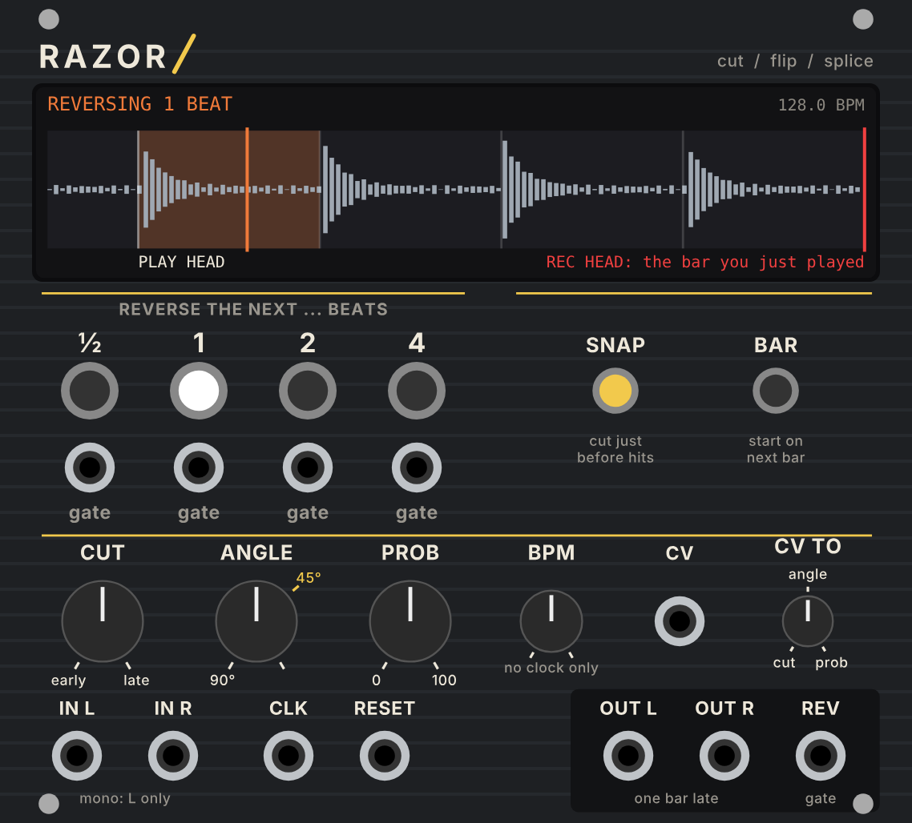

# Razor

A VCV Rack 2 module for **live reverse-tape splicing**: the old studio trick of
cutting a piece of tape out, turning it end for end, and splicing it back in
place, done on a running stream of audio.



## The idea

Most reverse effects flip the audio you have *just heard*, which repeats it.
A tape editor instead flips the piece that is *about to play*, so the music
carries on in time afterwards. To do that live, Razor works like a tape loop
with the record head **one bar (4 beats) ahead** of the play head:

- Everything you hear is the input exactly one bar late, locked to the clock,
  so it sits on the grid.
- The bar of tape between the two heads is recorded but not yet heard. It is
  always **the bar you just played**.
- Press **½, 1, 2 or 4** and that many beats of the tape ahead get played
  backwards from the next beat. Then the play head jumps to where it would have
  been anyway, so the forward music comes back exactly in time. Nothing repeats
  and nothing is lost.

One buffer covers all four lengths, because a one-bar gap always holds the
next 4 beats.

**What it costs:** the output is one bar behind the input. Send everything that
should stay in time with it through Razor too (or through a one-bar delay
locked to the same clock), and expect knob moves upstream to be heard a bar
later.

## The display

- **Top left:** what's happening: `FORWARD`, `ARMED 2 BEATS: next beat`
  (yellow), `REVERSING 1 BEAT` (orange), or `gate skipped (PROB)`.
- **Top right:** the tempo, plus `catching up` with the speed and how far
  off the grid the tape is, while it follows a tempo change.
- **The strip** is the tape between the heads. The white line on the left is
  the **play head** (what you hear), the red line on the right is the **record
  head**. Bar lines are brighter than beat lines; the small ticks along the top
  are the hits Razor has found (yellow when SNAP is on). A yellow box shows
  where an armed reverse will cut; an orange box is the piece being reversed,
  with the play head running backwards through it.

## Controls

| Control | What it does |
|---|---|
| **½ / 1 / 2 / 4** | Reverse that many beats, starting at the next beat (or bar, with BAR on). The light blinks while armed and stays on while it plays. Pressing during a reverse queues the next one, which starts the moment the current one ends. Buttons always fire. |
| **gate** jacks | The same as the buttons, for DROID, Marbles, a sequencer... Each gate is checked against **PROB** first. |
| **SNAP** | Razor looks at the bar ahead (which it can, because it's already on the tape) and puts each cut 2 ms before the nearest hit within ⅛ beat, so a cut never lands in the middle of a kick. CUT then fine-tunes from there. |
| **BAR** | Start on the next bar line, not the next beat. Patch **RESET** so Razor knows where your bar starts. |
| **CUT** | Moves both razor cuts earlier (CCW) or later (CW), up to ⅛ beat, the way moving a razor on real tape moves both the cut and the splice point. The reversed hits move twice as far as the knob, so small moves go a long way. Turn it CW to push the reversed hits later; turn it CCW so the reversed swell peaks before the beat. |
| **ANGLE** | The splice crossfade, as a razor-block angle. 90° is a butt splice (0.2 ms, clicky); **45°** (the yellow mark) is the classic angled cut, about 17 ms; fully CW is 22.5°, about 40 ms. These are the real numbers for ¼" tape at 15 ips. |
| **PROB** | The chance that a gate reverses (buttons always do). |
| **BPM** | The tempo when nothing is patched to **CLK**. |
| **CV** + **CV TO** | One CV input you aim at **cut**, **angle** or **prob**. CUT: ±5 V sweeps the whole knob. Angle and PROB: 0-10 V adds to the knob. |

## Jacks

| Jack | |
|---|---|
| **IN L / IN R** | Audio in. Mono: patch L only. |
| **CLK** | Clock. Default 1 pulse per beat; 2, 4 and 24 are in the right-click menu. The green light flashes on each beat. A big tempo change jumps the gap to one bar of the new tempo; small drifts are followed with varispeed. |
| **RESET** | The next beat is the first of a bar (for BAR). |
| **OUT L / OUT R** | The tape: one bar late, with the splices. |
| **REV** | 10 V while a reversed piece plays (to duck a reverb send, open a filter, trigger something...). |

Right-click menu: clock pulses per beat and **Clear the tape**.

## Patch ideas

1. **Reversed kick fills.** Four-to-the-floor kick into Razor. Arm **½** on beat
   4 of every 8th bar. With SNAP on, try CUT a little CCW so the reversed kick
   swells *into* the next downbeat.
2. **Self-editing loop (Autechre-ish).** A DROID `random` or Marbles t-outputs
   into the **gate** jacks, PROB around 25%, and a slow random CV into **CV**
   set to **cut**. Every pass gets its own edits, and nothing drifts off the
   grid because every splice lands back in time.
3. **REV as a modulation source.** REV into a VCA on a reverb send, so only the
   reversed pieces get washed out.

## Max for Live

There's also a Max for Live audio effect version for Ableton Live, with the same engine
ported to gen~: see [m4l/README.md](m4l/README.md).

## Building

The engine (`src/RazorEngine.hpp`) has no Rack code and is tested on its own:

```
c++ -std=c++11 -O2 -o test/engine_test test/engine_test.cpp && test/engine_test
```

The panel is drawn by `res/make_panel.py` (needs `fonttools`). GitHub Actions
builds the Mac (Apple Silicon) plugin on every push and puts it on the
**latest** release.
