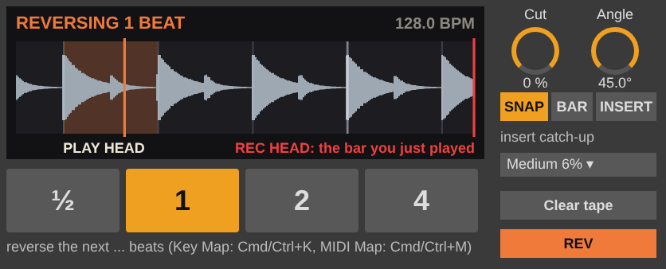

# Razor for Max for Live

The Razor reverse-tape splice as an Ableton Live **audio effect**. It does the same thing as the
VCV module: the play head runs exactly **one bar behind** the record head, so the next ½, 1, 2
or 4 beats are always already on the tape and can be cut out, played backwards and spliced
back in place, landing back on the grid.

*(a mock-up of the layout: the display is drawn by the real display script from the real engine)*

## Install

Put **Razor.amxd** and **razor_display.js** in the same folder (for example
`User Library/Presets/Audio Effects/Max Audio Effect/`) and drag Razor.amxd onto a track.
`razor_display.js` draws the display. To make one file that carries everything, open the
device in Max and press **Freeze Device**.

## Where to put it

Everything that comes out of Razor is one bar late. So:

- **On the master, a group, or a bus of the whole mix:** nothing to fix. Everything is late
  together, and you won't notice.
- **On a single track:** that track is a bar behind the rest. Either move the track's clips
  one bar earlier, or group it with everything it has to stay in time with and put Razor on
  the group.

It follows Live's tempo and transport by itself. Reverses only fire while Live is playing,
because they wait for the next beat. It assumes 4/4.

## Keyboard (and MIDI) triggering

The four big buttons are ordinary Live parameters, so Live's own mapping works:

1. Press **Cmd+K** (Mac) / **Ctrl+K** (Windows). The device's mappable controls turn yellow.
2. Click **½**, then press the key you want (say `1`). Then **1** -> `2`, **2** -> `3`,
   **4** -> `4`.
3. Press **Cmd/Ctrl+K** again to leave Key Map mode.

**Cmd/Ctrl+M** does the same for MIDI (pads, a keyboard or a controller). SNAP, BAR, INSERT
and Clear tape can be mapped the same way. The buttons can also be **automated** in the
Arrangement, so you can write reverses into the song.

## Controls

| Control | What it does |
|---|---|
| **½ / 1 / 2 / 4** | Reverse that many beats, starting at the next beat (or bar, with BAR). A press during a reverse starts the moment that one ends. |
| **Cut** | Moves both razor cuts up to ⅛ beat earlier (-) or later (+). Reversed hits move twice as far. |
| **Angle** | The splice crossfade as a razor-block angle: 90° is a butt splice (0.2 ms), 45° the classic cut (about 17 ms), 22.5° about 40 ms. Real numbers for ¼" tape at 15 ips. |
| **SNAP** | Puts each cut 2 ms before the nearest hit within ⅛ beat. Razor can do this because it's already holding the bar ahead. Cut then fine-tunes. |
| **BAR** | Start on the next bar line, not the next beat. |
| **INSERT** | Add the reversed piece in, not in place of the forward one. The tape then runs slightly fast until it's back to one bar late (a small pitch rise). **Insert catch-up** sets how fast: 2%, 6% or 12%. |
| **Clear tape** | Silence everything on the tape (for example after a break). |
| **REV** | Lights while a reversed piece plays. |

The display shows the tape between the heads: the white **play head** on the left (what you
hear), the red **record head** on the right (the bar you just played), beat and bar lines, a
yellow box where an armed reverse will cut, and an orange box for the piece being reversed.

## Files

- `razor.genexpr`: the engine (it goes in the gen~ codebox), ported from `src/RazorEngine.hpp`
- `razor_display.js`: the display ([jsui])
- `build_device.py`: writes `dist/Razor.amxd` (and a `.maxpat` copy for reading in Max)
- `test/gen_test.js`: turns the GenExpr into JavaScript and runs the same 10 checks as the VCV
  engine's tests: `node m4l/test/gen_test.js`
